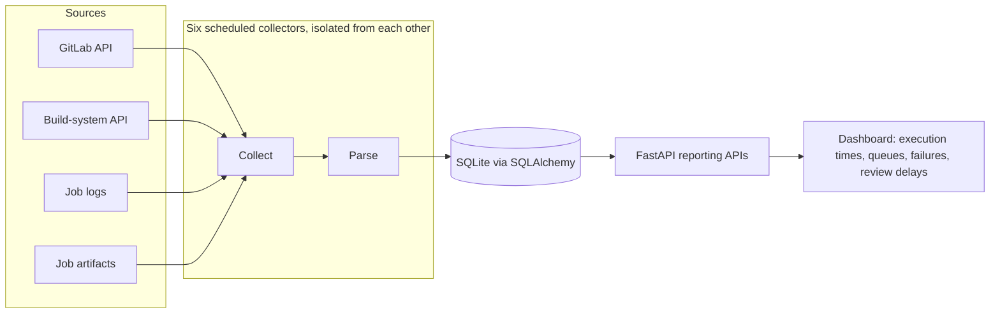

# ci-vitals: CI analytics service

**Problem.** Engineers could not see where CI time went: which pipelines were slow, how long jobs waited in queues, which jobs failed most, and how long merge requests waited for review. The data was spread across GitLab, the internal build system, logs and job artifacts.

**What I did.** I designed, built and deployed ci-vitals, a Python/FastAPI service with reporting APIs and a dashboard.

## How it works

- **Failure isolation.** Each collector runs on its own schedule. If one source is down, the others keep collecting and the reports show which data is stale.
- **Separated stages.** Collection, parsing, storage and reporting are separate layers, so a change in one source format touches only its parser.
- **Data contracts.** I documented every metric definition and its known limits, so engineers could tell a real slowdown from a gap in the data.

## Result

Engineers and team leads used the reports to find bottlenecks in CI and review flow instead of guessing.

**Stack:** Python, FastAPI, SQLAlchemy, SQLite, GitLab API, React/TypeScript for the dashboard (AI-assisted).
