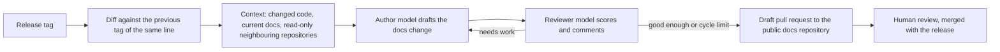

# DocSyncer: LLM pipeline that keeps public documentation in sync

**Problem.** Product releases changed behaviour faster than the public documentation was updated. Writing documentation by hand for every release lagged behind, and a blocking documentation check slowed developers down.

**What I did.** I designed and built DocSyncer, a GitLab CI pipeline that reads the changes in a release, uses LLMs to update the public documentation and opens a draft pull request for human review.

## How it works

- **Model per repository.** Each product repository chooses its model and reasoning effort in its own pipeline configuration. I added Anthropic Claude models alongside OpenAI.
- **Never blocks development.** The pipeline runs on release tags, not on merge requests, so it never delays a developer.
- **Safety rule.** Security fixes stay out of the automatic public pull request, because that pull request is public before the release is complete.

## Result

Documentation updates arrive as reviewable draft pull requests with each release. I ran pilots to measure the cost and duration of runs before choosing defaults per repository.

**Stack:** GitLab CI, Python, OpenAI and Anthropic APIs, GitHub pull requests.
