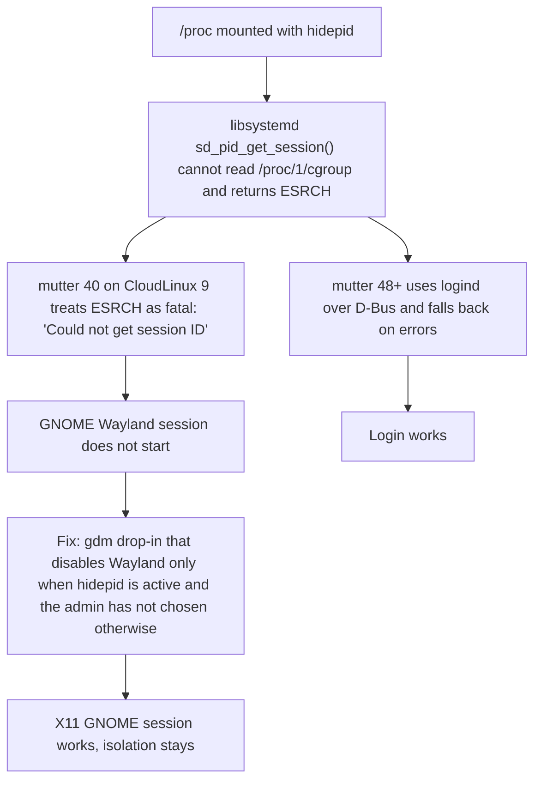

# Root cause: GNOME login fails under /proc hidepid

**Problem.** On CloudLinux 9 with a desktop installed, users could not log in to GNOME. CloudLinux mounts `/proc` with `hidepid` to isolate users from each other, and that isolation had to stay.

**What I did.** I traced the failure from the login screen down to a library call, compared it with newer systems and prepared a minimal fix that keeps isolation intact. I verified it on test VMs, with a control run without the fix.

## The chain I traced

Public references: [systemd issue #12955](https://github.com/systemd/systemd/issues/12955), [mutter merge request 4022](https://gitlab.gnome.org/GNOME/mutter/-/merge_requests/4022).

**Stack:** systemd, GDM, mutter, Linux /proc, test VMs.
