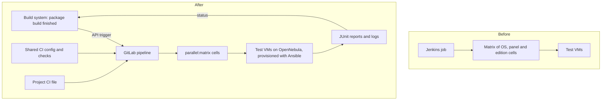

# Jenkins to GitLab CI migration for five teams

**Problem.** The department ran builds and VM-based tests for several operating systems on Jenkins. Jenkins was being retired, and five teams needed the same pipelines in GitLab CI without losing test coverage.

**What I did.** I owned the migration. I worked with team leads to agree scope and requirements, made the infrastructure decisions, migrated supporting systems, tuned resources and execution limits, set up monitoring and reported progress to management weekly.

## Before and after

## Details worth telling

- **Matrix jobs.** I ported Jenkins matrix jobs to GitLab CI `parallel:matrix`, including a 63-cell OS-conversion test matrix.
- **Build-system integration.** Package builds in the internal build system trigger the pipelines through its API, and the results flow back to the build.
- **Inventory dashboard.** A live page tracked 82 jobs with their merge requests, validation pipelines and build links, so every team saw what was done and what was blocked.
- **A bug class I found.** Ported jobs passed lists to Ansible as `-e key="a b c"`. Ansible splits that on spaces, so everything after the first value was silently dropped and part of the test input never reached the tests. I fixed the affected jobs and checked the others for the same pattern.
- **Secret redaction.** In the OS-conversion test suite I added `no_log` handling, redacted output and a unit test that enforces these rules in every matrix cell.

**Stack:** GitLab CI, Jenkins, Ansible, OpenNebula, Bash, Python, JUnit.
