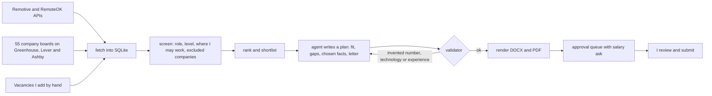

# job-apply: fact-checked CV and cover-letter pipeline

**Problem.** Tailoring a CV and a cover letter for every vacancy takes hours, and LLM-written applications tend to invent skills and numbers. I wanted automation that never claims more than my real CV says.

**What I built.** A Python pipeline with three judgment steps done by an AI agent (Claude Code) and deterministic checks around them. I approve every application and press Submit myself.

## How it works

## Design choices

- **The master CV is the only source of facts.** Each tailored bullet references a fact id. The validator rejects numbers that are not in that fact, technologies that are not in the master CV and any experience claim above "almost three years".
- **Gaps are honest.** Missing skills that can be learned in about two months go to a "Currently learning" line and a learning plan. Heavier gaps lower the fit score instead.
- **Salary ask.** The midpoint of a posted range, or the median of similar vacancies in the same market and level, and only when at least five vacancies from three companies post a range.

## Bugs the checks caught

- One job board marks onsite San Francisco roles as remote. Remote roles now pass only when the location names Poland, Europe or worldwide, or no region.
- The first salary median compared a Warsaw role with US salaries and senior bands. The peer filter now matches market and level, with a test.

**Stack:** Python, python-docx, SQLite, pytest, Claude Code. 35 tests.
