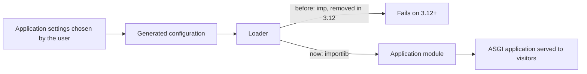

# Loading hosted Python applications on Python 3.12+

**Problem.** Hosting customers run Python web applications through the platform's application selector. Its loader used the `imp` module, which Python 3.12 removed, so applications on new Python versions could not start.

**What I did.** I replaced the imp-based loader with `importlib` and adapted how application configuration is generated and parsed. Hosted applications now load through ASGI on Python 3.12+ on CloudLinux and Ubuntu.

## Simplified flow

**Stack:** Python, importlib, ASGI, CloudLinux, Ubuntu.
